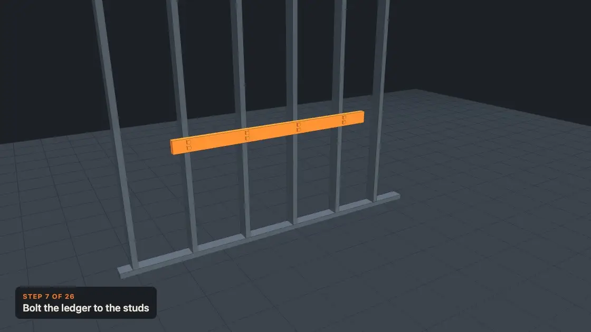
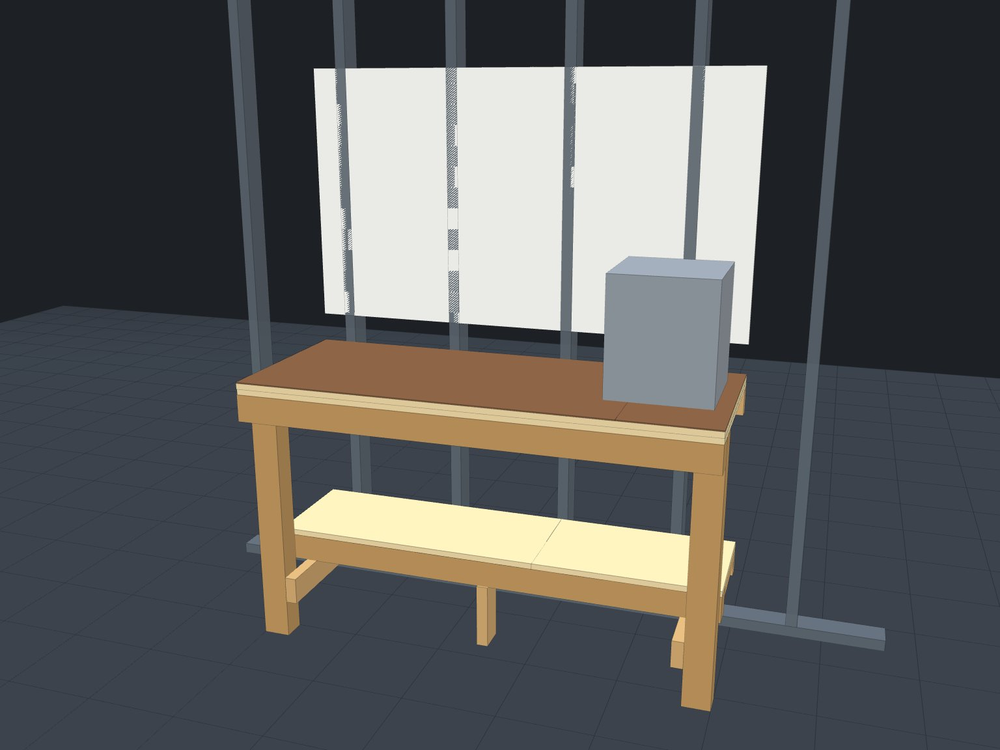
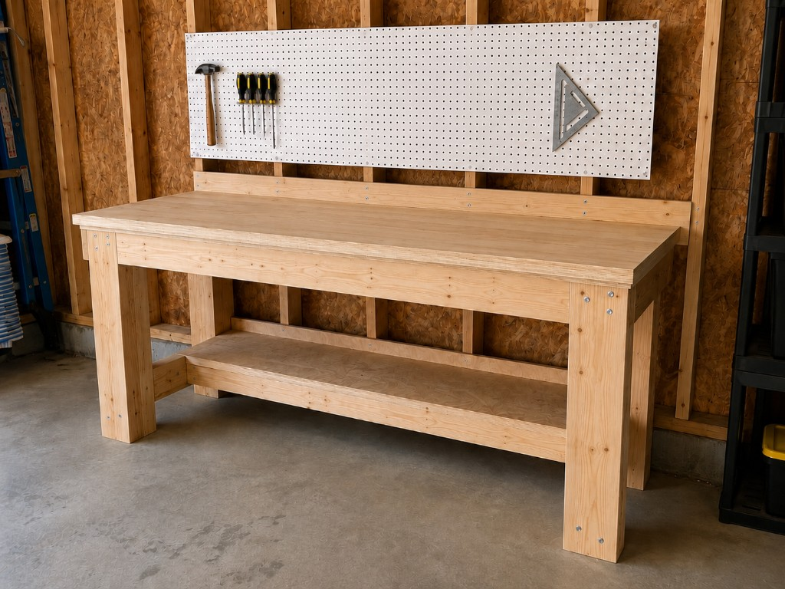
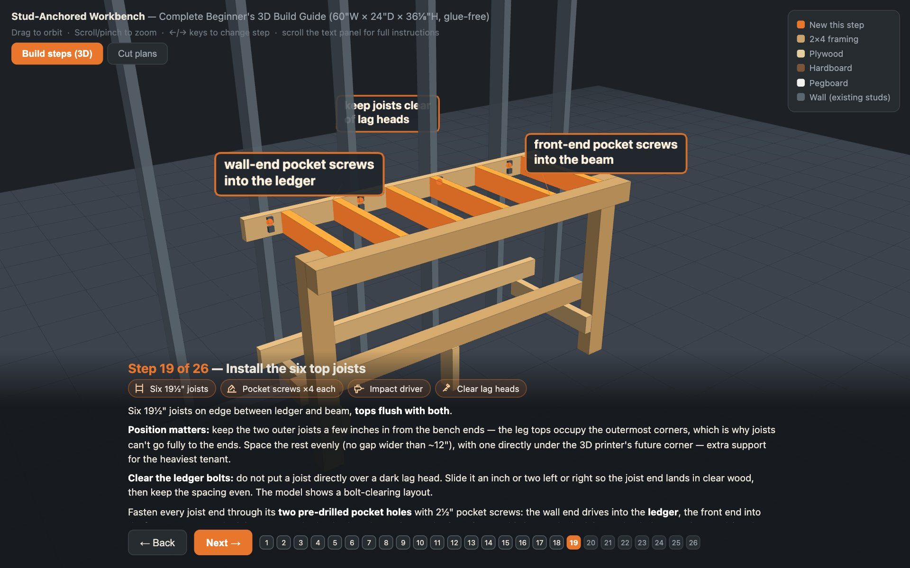
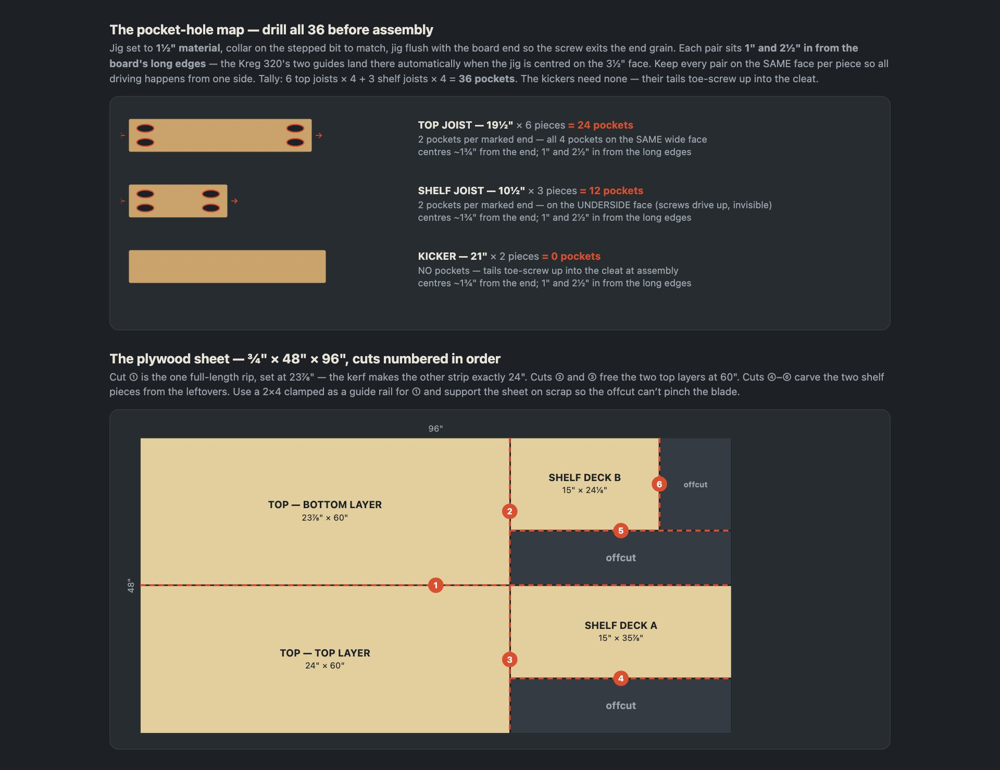

<div align="center">

# Stud-Anchored Workbench

**A garage workbench that hangs off the wall studs.<br>No rear legs, no glue, about $216 in materials.**

Designed with [Claude Code](https://claude.com/claude-code), with an interactive 3D guide that walks you through every cut and every screw.

### [Open the 3D build guide&nbsp;&nbsp;→](https://dpappo.github.io/workbench/)

<br>

<a href="https://dpappo.github.io/workbench/"></a>

<sub>60" W × 24" D × 36⅛" H&ensp;·&ensp;10 studs and one sheet of plywood&ensp;·&ensp;26 steps&ensp;·&ensp;beginner-friendly</sub>

</div>

<br>

The bench bolts its back edge straight into the wall framing of an unfinished garage. Two doubled front legs and a pair of kickers brace the front, and the building carries the rest, so the bench stays stiff without store-bought brackets or complicated joinery.

This repo is the whole project: the 3D guide, a printable written plan, and a shopping list with links. It isn't an application or a library. If you want to **build the bench**, start with the 3D guide. If you're curious how far an **AI-assisted design process** can go on a physical build (a kerf-aware cut list, a fastener plan, the reasoning behind every joint), read on.

## From the screen to the garage

<table>
<tr>
<td width="50%"></td>
<td width="50%"></td>
</tr>
<tr>
<td align="center"><sub><b>Designed</b> in the 3D guide</sub></td>
<td align="center"><sub><b>Built</b> on a bare stud wall</sub></td>
</tr>
</table>

## Build it

| Resource | What it is |
| --- | --- |
| **[Interactive 3D build guide](https://dpappo.github.io/workbench/)** | All 26 steps in 3D, from prep and cutting to the last screw. Orbit and zoom the model, step with <kbd>←</kbd> <kbd>→</kbd>. Each step lists the tools and fasteners it needs |
| **[Written build guide](stud-anchored-workbench-build-guide.md)** | The full printable plan: buy list, cut order, geometry checks, and every step in prose |
| **[Buy list](buy-list.md)** | Materials and tools with homedepot.ca links. Strike items off as you buy them |

### A guide that shows you the next step



New parts light up orange as they're added. Callouts mark layout lines and screw positions, chips list exactly what each step uses, and the text explains *why*, not just what: why a 2½" screw can't span a doubled member, where a pilot hole matters, why you level before you square.

### Cut plans, to scale



The **Cut plans** tab draws every board and sheet to scale, with the saw kerf included. Cuts are numbered in order, offcuts feed the next cut, and the pocket-hole map shows where every one of the 36 holes goes before assembly starts.

## How it stands up

- **Stud-anchored ledger.** The back of the top hangs off a ledger lagged into the studs, so there are no rear legs to trip over
- **Doubled 2×4 frame.** The beam and legs are two boards screwed face to face for stiffness
- **Kickers and a shelf diaphragm.** Kickers tie the legs back to a cleat on the wall, and the shelf deck locks the frame against racking
- **Pocket-hole joinery.** All 36 angled joints use a Kreg 320 jig, drilled while the parts are still loose on the bench. The kicker tails, rail and optional post use old-school toe-screws
- **Replaceable hardboard top.** A sacrificial wear surface you swap for about $11 when it gets beat up
- **Open stud bays.** The pegboard mounts straight to the studs, with no spacer strips

| At a glance | |
| --- | --- |
| **Size** | 60" wide, 24" deep, 36⅛" to the work surface, with a shelf at 12¾" and 9" of knee room |
| **Materials** | 10 SPF 2×4s, one sheet of ¾" plywood, one ⅛" hardboard panel, optional pegboard |
| **Fasteners** | 12 lag bolts into the studs, 36 pocket screws, and two sizes of construction screw. No glue anywhere |
| **Cost** | About $172 for the bench, about $216 with pegboard, plus a $49 Kreg 320 jig you'll keep using (Ontario big-box prices) |
| **Tools** | Drill, circular saw, rafter square, level, ratchet, a clamp and the pocket-hole jig |

## Designed with Claude Code

The geometry, fastener logic, kerf-aware cut list and teaching copy were worked out in conversation with [Claude Code](https://claude.com/claude-code), through five verification passes on stability, knee clearance under the shelf, fastener physics and beginner-friendly explanations (pocket holes vs. toe-screws, doubled members, why garage floors slope).

The design kept improving as it went. A few of the changes that came out of that back-and-forth, all visible in the commit history:

- The angled joints moved from toe-screws to **pocket holes**, which turned the most awkward fastening in the build into easy driving
- The wall blocks were dropped: the kicker tails now **toe-screw up into the cleat** instead, so nothing shows on the wall
- The countersink bit was dropped too, in favour of a **⅜" twist bit spun in reverse** at the mouth of each pilot hole
- The cut plans gained a **to-scale pocket-hole map**, so the 36 pockets are drilled from a drawing rather than from memory

The 3D guide is a single HTML file with three.js. There's no build step, and GitHub Pages serves it straight from this repo.

<details>
<summary><b>What's in the repo</b></summary>
<br>

```
.
├── index.html                                # Interactive 3D build guide (GitHub Pages)
├── stud-anchored-workbench-build-guide.md    # Full written build plan
├── buy-list.md                               # Shopping checklist (strike off as you buy)
├── assets/workbench.png                      # The finished bench
├── assets/readme/                            # README images, rendered from the 3D guide
├── scripts/readme-media.mjs                  # Renders those images (npm run readme-media)
├── scripts/animate.py                        # Encodes the build animation
└── .github/workflows/pages.yml               # Deploys the 3D guide to GitHub Pages
```

</details>

<details>
<summary><b>Updating the README images</b></summary>
<br>

Every image here except the photo is rendered from the 3D guide itself, so after changing `index.html` you can bring them back in line:

```bash
npm install
npm run readme-media
```

It uses your installed Chrome if you have one, and Python 3 with Pillow to encode the animation. `assets/readme/social.jpg` is the repo's link preview; GitHub doesn't read it from the repo, so upload it under **Settings → General → Social preview** when it changes.

</details>

<br>

<p align="center"><b>Built one?</b> Open an issue with a photo, or with anything the guide could explain better.</p>
